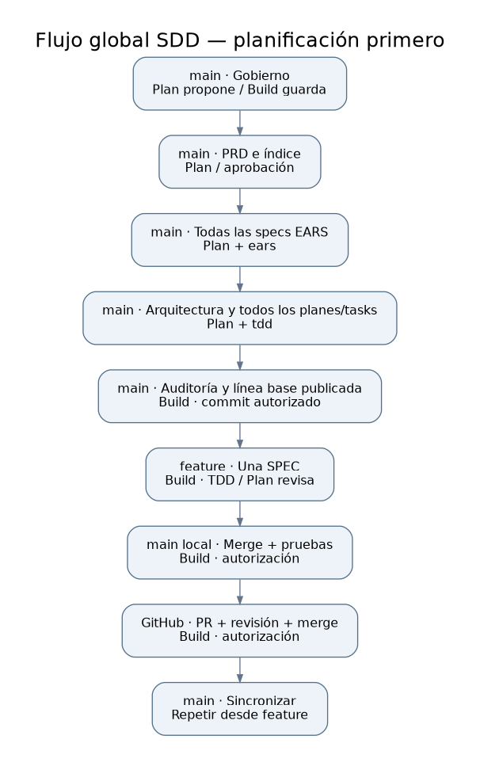
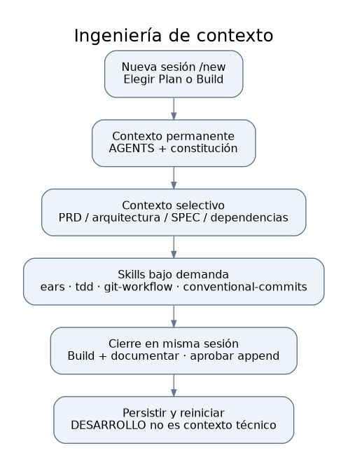
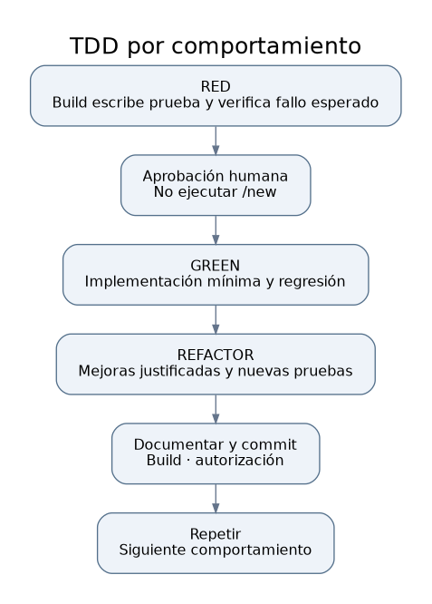
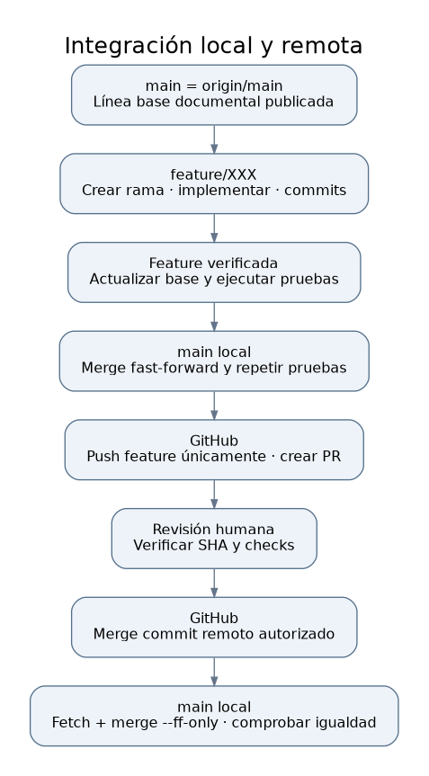
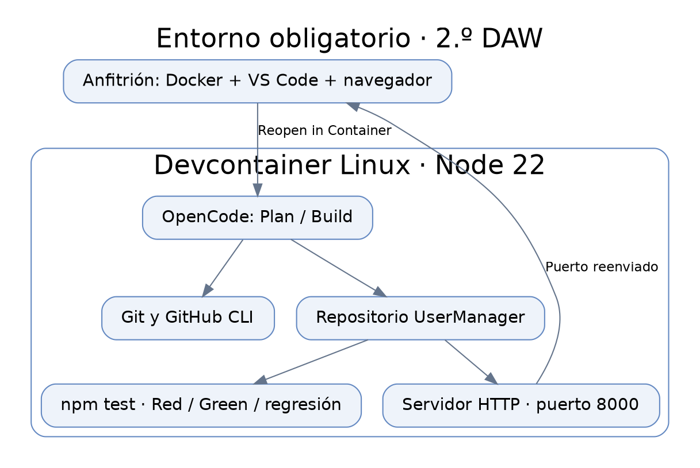

# UserManager 2.º DAW — Guion privado del profesor (v6)
No distribuir Profesor ni pedir a OpenCode que lea este archivo. Copiar solo el prompt activo. Los pasos son previstos; DESARROLLO contiene solo lo realmente ejecutado. Sustituir [SPEC-ID y ruta] por valores aprobados. Las fases 000–019 se hacen antes de programar; 020–027 se repiten por cada SPEC; 029–030 cierran el proyecto. Cada cambio de agente para guardar conserva sesión; /new solo donde se indica.

## Entorno obligatorio
El profesor entrega .devcontainer preconfigurado como infraestructura, no como arquitectura. Todas las sesiones OpenCode, comandos Git/gh, desarrollo y pruebas se realizan en el contenedor; navegador del anfitrión solo mediante puerto reenviado. Si no funciona, detenerse.

## Mapa global






## Cierre reutilizable de un paso
Cambiar a Build sin /new, ejecutar el prompt siguiente, revisar y autorizar el append. No documentar propuestas como ejecutadas. Antes de /new persistir artefactos técnicos. No interrumpir Red–Green–Refactor.
```text
Carga la skill documentar y documenta el paso que acabamos de realizar. Presenta la propuesta y espera autorización antes de añadirla.
```
Los commits incluyen únicamente entradas aprobadas y pertinentes. Después de fusionar un PR, la entrada de integración real se conserva por el profesor fuera del repositorio hasta la próxima feature o se incorpora mediante PR documental final. No crear un bucle infinito de documentación de su propio PR.

## Permisos
Configuración inicial V2: `permissions`, `shell`, `edit`, `subagent`. V1 usa `permission`, `bash`, `edit`, `task`; adaptar según versión instalada y documentación oficial https://opencode.ai/docs/permissions/ . No aceptar Always Allow ni autoaccept. Los permisos de shell no son sandbox. Las reglas piden confirmación para escrituras; el permiso de push a main solo se admite en la fase documental inicial por autorización explícita, y debe bloquearse al finalizarla (cambio aprobado de configuración incluido en la línea base antes de publicar, o protección remota tras publicar). Si se bloquea antes, el humano publica la línea base según política. Nunca eludir protecciones. GitHub CLI debe estar autenticado por el alumno; no pedir tokens. No permitir subagentes. Verificar en la instalación real.

## Paso 000. Preparación

**Agente:** Humano · **`/new`:** No · **Skills:** —

**Contexto:** Terminal y repositorio

```text
No hay prompt. En el anfitrión comprobar Docker y VS Code con Dev Containers. Clonar o preparar UserManager (Profesor fuera) y abrir Reopen in Container. En la terminal del contenedor comprobar whoami, pwd, test -f /.dockerenv, git --version, gh --version, opencode --version, node --version y npm --version. Autenticarse personalmente con gh auth login; gh auth status; gh auth setup-git si se usa HTTPS. Configurar identidad Git. Abrir OpenCode desde la raíz dentro del contenedor. Comprobar modelo y permisos. Si no arranca, resolver antes de continuar; no usar herramientas del anfitrión.
```

**Punto de control y aprendizaje:** Distinguir terminal de OpenCode. Usar /new en OpenCode, no en PowerShell. Confirmar permisos antes de trabajar.

---

## Paso 001. Proponer constitución

**Agente:** Plan · **`/new`:** Sí · **Skills:** —

**Contexto:** Plantillas de arranque

```text
Propón constitution.md para una práctica de 2.º DAW con SDD, EARS, Given–When–Then, TDD Red–Green–Refactor, arquitectura deducida, simplicidad, separación, seguridad, regresión, trazabilidad, aprobación humana y Git por funcionalidad. Restricciones: HTML5, CSS3, JavaScript vanilla y módulos ES, manipulación nativa del DOM; sin frameworks, backend ni bundler obligatorio; localStorage y JSON; node:test y node:assert/strict; lógica independiente del DOM y almacenamiento en pruebas unitarias. Autenticación simulada cliente, manipulable; solo cuentas ficticias; Web Crypto PBKDF2 con salt aleatorio; servir por HTTP desde el devcontainer mediante puerto reenviado 8000. Desarrollo y pruebas exclusivamente en el devcontainer; preservar esta restricción. Primero toda la planificación en main; después ramas, merge local fast-forward, pruebas y PR remoto revisado. Build pide autorización para cada operación Git/GitHub de escritura. Diferencia principios de procedimientos; pregunta ambigüedades, no escribas archivos ni código.
```

**Punto de control y aprendizaje:** El alumno explica un principio y diferencia de decisión técnica. Aprobar la propuesta.

---

## Paso 002. Guardar constitución

**Agente:** Build · **`/new`:** No · **Skills:** documentar al cierre

**Contexto:** Propuesta aprobada de la sesión

```text
La propuesta ha sido revisada y aprobada. Guarda exclusivamente el texto aprobado en las rutas indicadas. Solicita autorización antes de escribir; no añadas decisiones ni generes código. Destino: constitution.md.
```

**Punto de control y aprendizaje:** Comprobar el archivo antes de reiniciar.

---

## Paso 003. Proponer AGENTS.md

**Agente:** Plan · **`/new`:** Sí · **Skills:** —

**Contexto:** Constitución aprobada, plantilla AGENTS y metadatos de skills

```text
Propón AGENTS.md breve. Solo Plan/Build; Plan propone sin escribir, Build guarda y ejecuta con autorización. /new por fase independiente y SPEC; conservar sesión al guardar y entre Red/Green. Carga selectiva de ears, tdd, git-workflow, conventional-commits y documentar. Fases: gobierno, PRD, índice, todas las specs, arquitectura global y todos los planes/tareas en main; auditoría y línea base publicada; implementación incremental por ramas. Incluir puntos de aprobación, revisión independiente, cambio controlado de requisitos y contratos, autorización Git/gh, PR y sincronización. PASOS fuera del repositorio; DESARROLLO no es contexto técnico, solo append autorizado con documentar. No duplicar skills ni constitución. Mantén la obligación de ejecutar OpenCode, Git, gh, Node/npm y todas las pruebas dentro del devcontainer; navegador anfitrión solo para UI por puerto reenviado. No escribir.
```

**Punto de control y aprendizaje:** Distinguir instrucciones persistentes, principios y permisos técnicos.

---

## Paso 004. Guardar AGENTS.md

**Agente:** Build · **`/new`:** No · **Skills:** documentar al cierre

**Contexto:** Propuesta aprobada

```text
La propuesta ha sido revisada y aprobada. Guarda exclusivamente el texto aprobado en las rutas indicadas. Solicita autorización antes de escribir; no añadas decisiones ni generes código. Destino AGENTS.md; conserva salvaguardas.
```

**Punto de control y aprendizaje:** Verificar coherencia con constitución.

---

## Paso 005. Validar skills y permisos

**Agente:** Plan · **`/new`:** Sí · **Skills:** las cinco, solo en esta auditoría

**Contexto:** Configuración, constitución, AGENTS y skills

```text
Comprueba compatibilidad de las cinco skills y opencode.json con las reglas aprobadas y la versión instalada. Explica permisos frente a instrucciones. Verifica que solo se autoriza push a main durante línea base documental y no después; no se permite saltar protecciones. Propón correcciones sin escribir.
```

**Punto de control y aprendizaje:** Comprobar descubrimiento de skills; no aceptar reglas globales autoaccept.

---

## Paso 006. Aplicar correcciones

**Agente:** Build · **`/new`:** No · **Skills:** documentar al cierre

**Contexto:** Propuestas aprobadas

```text
La propuesta ha sido revisada y aprobada. Guarda exclusivamente el texto aprobado en las rutas indicadas. Solicita autorización antes de escribir; no añadas decisiones ni generes código. Aplica solo correcciones autorizadas; indica si hay que reiniciar OpenCode.
```

**Punto de control y aprendizaje:** Reiniciar aplicación si cambia configuración; probar permisos con acciones controladas. Documentar antes de reiniciar.

---

## Paso 007. Commit gobierno

**Agente:** Build · **`/new`:** Sí · **Skills:** git-workflow, conventional-commits

**Contexto:** Main y artefactos aprobados

```text
Carga git-workflow y conventional-commits. Revisa rama, diff y archivos; propón stage selectivo y mensaje Conventional Commits. Solicita autorización separada antes de cada escritura. Informa del SHA y estado real.
```

**Punto de control y aprendizaje:** Primer commit documental; no hay código.

---

## Paso 008. Idea inicial y PRD

**Agente:** Plan · **`/new`:** Sí · **Skills:** —

**Contexto:** prd.md plantilla, constitución, AGENTS

```text
Quiero desarrollar una aplicación web de una sola página llamada UserManager utilizando Spec-Driven Development (SDD) y Test-Driven Development (TDD).
La aplicación tendrá una pantalla de login con nombre y contraseña y una pantalla de registro. El primer usuario que se registre será administrador. Los siguientes registros públicos crearán usuarios estándar. Al iniciar sesión, un administrador podrá consultar, añadir y eliminar usuarios y decidir si el usuario añadido es administrador. Los usuarios estándar verán un saludo con su nombre. Ambos podrán cerrar sesión y volver al login. Los usuarios y sus roles se conservarán al recargar o volver a abrir la aplicación en el mismo origen. La interfaz cambiará dinámicamente mediante el DOM; no se intentará cerrar la pestaña por código.
Restricciones: HTML5, CSS3 y JavaScript vanilla con módulos ES; manipulación del DOM con APIs nativas (querySelector, createElement, textContent y addEventListener); sin frameworks, TypeScript, backend ni bundler obligatorio. Persistencia mediante localStorage y JSON; lógica aislada del DOM y del almacenamiento. Pruebas unitarias con node:test y node:assert/strict; Node.js solo para herramientas y pruebas. Usar Web Crypto PBKDF2 con salt aleatorio para cuentas ficticias, sin almacenar contraseñas en texto plano; explicar que la autorización cliente es simulada y manipulable. Servir por HTTP desde el devcontainer mediante puerto reenviado 8000. Desarrollo local, Node/npm y todas las pruebas dentro del devcontainer. Git/GitHub. Es una práctica sencilla de 2.º DAW, Desarrollo Web en Entorno Cliente. No usar credenciales reales.
Lee las instrucciones y la constitución. Identifica visión, objetivos, actores, requisitos funcionales y no funcionales, alcance, exclusiones, casos límite y criterios globales de éxito. Identifica ambigüedades y pregúntame antes de resolverlas. Propón un PRD con identificadores estables usando la plantilla prd.md. No diseñes arquitectura, módulos, directorios ni funciones; no generes código ni escribas archivos.
```

**Punto de control y aprendizaje:** Distinguir producto y diseño; resolver dudas en misma sesión. No imponer arquitectura.

---

## Paso 009. Guardar PRD

**Agente:** Build · **`/new`:** No · **Skills:** documentar, conventional-commits

**Contexto:** PRD aprobado

```text
La propuesta ha sido revisada y aprobada. Guarda exclusivamente el texto aprobado en las rutas indicadas. Solicita autorización antes de escribir; no añadas decisiones ni generes código. Destino prd.md. Después de documentar, Carga git-workflow y conventional-commits. Revisa rama, diff y archivos; propón stage selectivo y mensaje Conventional Commits. Solicita autorización separada antes de cada escritura. Informa del SHA y estado real.
```

**Punto de control y aprendizaje:** PRD aprobado y commit independiente en main.

---

## Paso 010. División del producto

**Agente:** Plan · **`/new`:** Sí · **Skills:** —

**Contexto:** PRD e índice plantilla

```text
Propón todas las especificaciones pequeñas, IDs, ramas, alcance, referencias al PRD y dependencias; incluye infraestructura si necesaria. Comprueba cobertura y ausencia de ciclos. No fijes número ni arquitectura. No escribas.
```

**Punto de control y aprendizaje:** Explicar orden y cobertura del producto.

---

## Paso 011. Guardar índice

**Agente:** Build · **`/new`:** No · **Skills:** documentar al cierre

**Contexto:** Índice aprobado

```text
La propuesta ha sido revisada y aprobada. Guarda exclusivamente el texto aprobado en las rutas indicadas. Solicita autorización antes de escribir; no añadas decisiones ni generes código. Destino docs/specs/index.md.
```

**Punto de control y aprendizaje:** Sin ramas funcionales todavía.

---

## Paso 012. Especificar cada funcionalidad (repetir para todas)

**Agente:** Plan · **`/new`:** Sí por SPEC · **Skills:** ears

**Contexto:** PRD, índice, template spec y dependencias

```text
Carga ears. Para [SPEC-ID y ruta], redacta requisitos EARS atómicos, RNF medibles, criterios Dado–Cuando–Entonces, errores, alcance, historia y trazabilidad. Pregunta ambigüedades y espera respuestas; no escribas ni diseñes código.
```

**Punto de control y aprendizaje:** Cada requisito tiene aceptación verificable y referencia al PRD.

---

## Paso 013. Guardar cada spec

**Agente:** Build · **`/new`:** No · **Skills:** documentar al cierre

**Contexto:** Spec aprobada

```text
La propuesta ha sido revisada y aprobada. Guarda exclusivamente el texto aprobado en las rutas indicadas. Solicita autorización antes de escribir; no añadas decisiones ni generes código. Destino spec.md de la funcionalidad activa. Repetir 012–013 para todas las specs antes de seguir.
```

**Punto de control y aprendizaje:** Todas las specs están aprobadas en main; aún no hay código.

---

## Paso 014. Arquitectura global

**Agente:** Plan · **`/new`:** Sí · **Skills:** tdd si necesita criterios de aislamiento

**Contexto:** PRD, todas las specs, plantilla architecture

```text
Propón arquitectura global coherente con todas las specs. Compara alternativas, responsabilidades, dependencias, contratos compartidos y directorios necesarios. Justifica testabilidad y simplicidad; distingue estructura prevista de infraestructura mínima inicial. Usa templates/architecture.md. No escribas ni generes código.
```

**Punto de control y aprendizaje:** Explicar alternativas y dependencias; no imponer arquitectura inicial.

---

## Paso 015. Guardar arquitectura

**Agente:** Build · **`/new`:** No · **Skills:** documentar al cierre

**Contexto:** Arquitectura aprobada

```text
La propuesta ha sido revisada y aprobada. Guarda exclusivamente el texto aprobado en las rutas indicadas. Solicita autorización antes de escribir; no añadas decisiones ni generes código. Destino docs/architecture.md.
```

**Punto de control y aprendizaje:** Decisiones globales persistidas.

---

## Paso 016. Plan y tareas de cada spec (repetir para todas)

**Agente:** Plan · **`/new`:** Sí por SPEC · **Skills:** tdd

**Contexto:** Arquitectura, spec activa, dependencias, plantillas plan/tasks

```text
Carga tdd. Para [SPEC-ID y ruta] elabora plan y tasks desde la arquitectura y requisitos aprobados. Define contratos sin cuerpos, alternativas, pruebas y ciclos pequeños Red–Green–Refactor; infraestructura y UI con comprobaciones adecuadas. Usa las plantillas. No escribas ni implementes.
```

**Punto de control y aprendizaje:** Comprender contrato, tarea y prueba; no implementar comportamientos antes de Red.

---

## Paso 017. Guardar plan y tareas

**Agente:** Build · **`/new`:** No · **Skills:** documentar al cierre

**Contexto:** Plan y tasks aprobados

```text
La propuesta ha sido revisada y aprobada. Guarda exclusivamente el texto aprobado en las rutas indicadas. Solicita autorización antes de escribir; no añadas decisiones ni generes código. Destinos plan.md y tasks.md de la spec. Repite 016–017 para todas.
```

**Punto de control y aprendizaje:** Todos los planes aprobados antes de programación.

---

## Paso 018. Auditoría documental global

**Agente:** Plan · **`/new`:** Sí · **Skills:** ears, tdd

**Contexto:** PRD, todas las specs, arquitectura y planes/tareas

```text
Audita cobertura PRD, EARS, aceptación, dependencias, compatibilidad de contratos, trazabilidad y ciclos TDD. Identifica bloqueos y correcciones propuestas sin escribir.
```

**Punto de control y aprendizaje:** Resolver inconsistencias antes de establecer línea base.

---

## Paso 019. Consolidar y publicar línea base

**Agente:** Build · **`/new`:** No tras 018; Sí si ya se guardó todo · **Skills:** git-workflow, conventional-commits, documentar

**Contexto:** Auditoría y correcciones aprobadas

```text
Guarda solo correcciones aprobadas. Documenta el paso. Carga git-workflow y conventional-commits. Revisa rama, diff y archivos; propón stage selectivo y mensaje Conventional Commits. Solicita autorización separada antes de cada escritura. Informa del SHA y estado real. Propón publicar exclusivamente la línea base documental en main antes de implementar; pide autorización. Si main está protegida usa rama documental y PR según política. Comprueba main y origin/main iguales y limpios.
```

**Punto de control y aprendizaje:** Commit docs: approve specification baseline. No código, todas las specs y planes aprobados; no push directo a main después.

---

## Paso 020. Crear rama funcional (inicio del ciclo repetible)

**Agente:** Build · **`/new`:** Sí · **Skills:** git-workflow

**Contexto:** Índice, Git y dependencias integradas

```text
Carga git-workflow. Para [SPEC-ID y ruta], comprueba main sincronizada y limpia, dependencias integradas y documentos aprobados. Propón y crea rama feature desde main previa autorización de cada escritura.
```

**Punto de control y aprendizaje:** Una rama por SPEC; no generar de nuevo las specs.

---

## Paso 021. Implementar RED

**Agente:** Build · **`/new`:** Sí al iniciar SPEC; No entre ciclos · **Skills:** tdd

**Contexto:** Spec, plan, tasks, arquitectura y código pertinente

```text
Carga tdd. Implementa solo [SPEC-ID y ruta]. Comprueba vigencia del plan; si hay desviaciones detente y solicita Plan. Identifica tarea pendiente y solicita autorización. Escribe prueba del comportamiento antes de implementarlo; contrato mínimo compilable si necesario. Ejecuta Red y muestra fallo real esperado; espera autorización Green. Infraestructura inicial: validar el devcontainer suministrado, configurar comandos de proyecto y prueba de humo dentro del contenedor; no simular TDD.
```

**Punto de control y aprendizaje:** El alumno observa un fallo por comportamiento, no error de infraestructura.

---

## Paso 022. GREEN y REFACTOR

**Agente:** Build · **`/new`:** No · **Skills:** tdd

**Contexto:** Red y aprobación de la sesión

```text
Autorizo Green de la tarea revisada. Implementa mínimo, ejecuta prueba y regresión. Propón refactor justificado, espera autorización y vuelve a probar. Actualiza tasks y evidencias reales. No avances a otra tarea sin aprobación.
```

**Punto de control y aprendizaje:** Repetir 021–022 por comportamiento. Documentar tras ciclo completo. npm test dentro del devcontainer (script basado en node --test); comprobación manual por HTTP puerto reenviado y DevTools cuando proceda. No exigir compilación ni bundler.

---

## Paso 023. Commit de ciclo

**Agente:** Build · **`/new`:** No · **Skills:** documentar, conventional-commits, git-workflow

**Contexto:** Ciclo terminado

```text
Carga la skill documentar y documenta el paso que acabamos de realizar. Presenta la propuesta y espera autorización antes de añadirla. Después de aprobación, Carga git-workflow y conventional-commits. Revisa rama, diff y archivos; propón stage selectivo y mensaje Conventional Commits. Solicita autorización separada antes de cada escritura. Informa del SHA y estado real.
```

**Punto de control y aprendizaje:** Revisar diff y evidencia TDD; commits parciales permitidos en feature, nunca integrar rojo.

---

## Paso 024. Revisión independiente

**Agente:** Plan · **`/new`:** Sí · **Skills:** ears y tdd según alcance

**Contexto:** Spec, plan, tasks, arquitectura, código y pruebas

```text
Revisa [SPEC-ID y ruta] de forma independiente. Compara requisitos, criterios, contratos, pruebas y constitución. No modifiques archivos. Presenta hallazgos numerados y gravedad.
```

**Punto de control y aprendizaje:** Detectar desviaciones y pruebas insuficientes; guardar informe aprobado con Build en misma sesión antes de /new.

---

## Paso 025. Verificación y cierre técnico

**Agente:** Build · **`/new`:** Sí · **Skills:** tdd, documentar, conventional-commits

**Contexto:** Hallazgos guardados y artefactos activos

```text
Corrige solo hallazgos autorizados mediante TDD cuando proceda. Ejecuta npm test dentro del devcontainer (script basado en node --test); comprobación manual por HTTP puerto reenviado y DevTools cuando proceda. No exigir compilación ni bundler.. Verifica aceptación manual/integración cuando aplique; registra trazabilidad y resultados reales en verification.md, tasks e índice (verificada, no fusionada). Documenta y propón commit final autorizado.
```

**Punto de control y aprendizaje:** Todas las pruebas obligatorias pasan; no inventar conteos ni afirmar PR fusionado.

---

## Paso 026. Integración local y PR

**Agente:** Build · **`/new`:** Sí · **Skills:** git-workflow, conventional-commits

**Contexto:** Rama limpia, SHA verificado, política GitHub

```text
Carga git-workflow. Actualiza feature respecto a main y repite pruebas dentro del devcontainer. Solicita autorización para merge --ff-only en main local; vuelve a probar. Si todo pasa, pide autorización para push exclusivo de feature y después para gh pr create. Muestra base/head/SHA, título, cuerpo según plantilla y evidencia. No publiques main. No fusiones PR todavía.
```

**Punto de control y aprendizaje:** Comprender por qué origin/main queda sin cambios hasta PR; comprobar URL real.

---

## Paso 027. Revisión, merge remoto y sincronización

**Agente:** Build + humano · **`/new`:** No · **Skills:** git-workflow

**Contexto:** PR real y SHA probado

```text
Consulta gh pr view y checks requeridos. Espera revisión humana real. Si head/base cambiaron, detente. Tras autorización nueva, fusiona mediante gh pr merge --merge --match-head-commit SHA. Comprueba MERGED; solicita autorización para fetch y merge --ff-only origin/main. Comprueba SHA iguales, estado limpio y pruebas dentro del devcontainer. No inicies otra SPEC.
```

**Punto de control y aprendizaje:** Registrar integración real en PR; no fingir aprobación. Documentar cierre después y no dejar main sucia: entrada fuera del repo hasta próxima rama o PR documental final.

---

## Paso 028. Siguiente especificación

**Agente:** Build · **`/new`:** Sí · **Skills:** git-workflow

**Contexto:** Índice y PRs fusionados

```text
Comprueba que la SPEC previa está integrada y sincronizada y que la próxima tiene dependencias satisfechas. No modifiques documentos sin aprobación. Repite desde 020.
```

**Punto de control y aprendizaje:** Revisar vigencia de cada plan. Si cambia, usar Plan y aprobar actualización en feature antes de continuar.

---

## Paso 029. Auditoría final

**Agente:** Plan · **`/new`:** Sí · **Skills:** ears, tdd

**Contexto:** PRD, specs, arquitectura, código y verificación

```text
Audita el producto completo frente a PRD y constitución. Comprueba cobertura, regresión, trazabilidad, integración de specs y limitaciones. No escribas archivos.
```

**Punto de control y aprendizaje:** Diferenciar cumplimiento de cada spec y del producto global.

---

## Paso 030. Demostración y cierre

**Agente:** Build · **`/new`:** Sí · **Skills:** tdd, documentar

**Contexto:** Auditoría aprobada y producto

```text
Ejecuta las comprobaciones finales autorizadas: npm test dentro del devcontainer (script basado en node --test); comprobación manual por HTTP puerto reenviado y DevTools cuando proceda. No exigir compilación ni bundler.. Demuestra registro, login, roles, administración, persistencia y logout. Registra resultados reales. No modifiques main; cualquier corrección o documentación final requiere rama y PR.
```

**Punto de control y aprendizaje:** Defensa individual: explicar requisito EARS, contrato, ciclo TDD, DOM y PR.


## Prompt auxiliar de cambio de plan
```text
Detén la implementación. Cambiaré a Plan con /new tras guardar el problema y estado en tasks.md. Analiza la desviación respecto a spec/architecture/plan, propón cambios mínimos y efectos sobre dependencias. Tras aprobación, Build guarda los artefactos en la rama activa y se reinicia para implementar. No improvises ni alteres requisitos para que pasen pruebas.
```
